  

  

  <a href="https://github.com/dhoang15/Nhom19minicloud">Nhom19minicloud</a> · <a href="https://github.com/dhoang15/web_pos_fashion">web_pos_fashion</a>

  

  

  

  

  auto-updated by GitHub Actions · last run 2026-11-28

